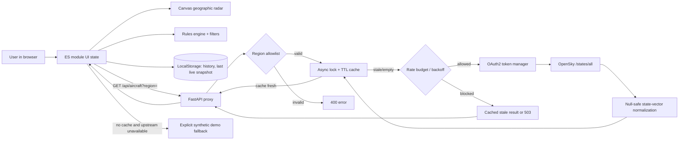
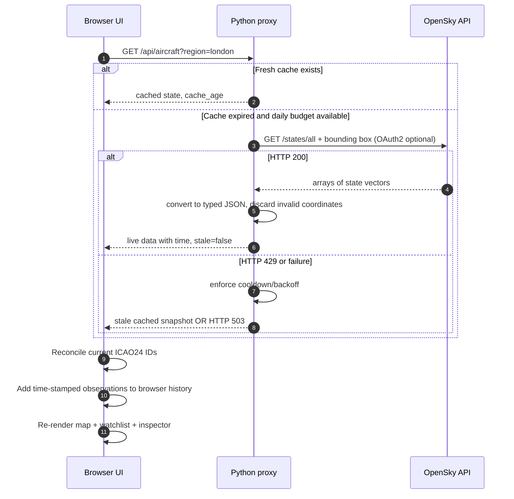
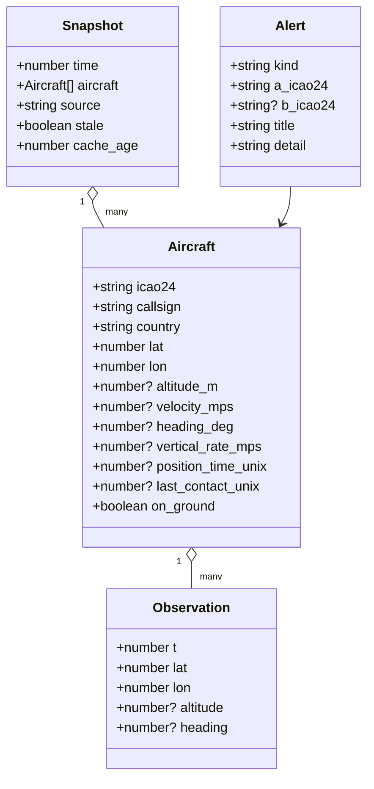

# SkySentinel — Architecture & Data Flow

## 1. Challenge alignment

**Original task:** “Air Traffic Control,” CodeChef-VIT Promotional Cycle 2026–27, Technical Challenges > Frontend Development, pages 8–9. Goal: a dashboard that monitors aircraft in a selected region, even with unreliable API updates, missing fields, late arrivals, and quota limitations.

## 2. Architecture diagram

The frontend deliberately uses **native JavaScript modules + HTML Canvas**, rather than a framework that requires a network-time npm installation. The official task permits an equivalent stack. The Python application is a small *API proxy*, not a general business-logic backend. This makes the frontend project's behavior testable without exposing any OpenSky credentials.

## 3. Aircraft lifecycle (snapshots)

Snapshot changes: an ICAO24 that is in the next snapshot but not the previous is considered newly observed; an ICAO24 that disappears is **not deleted from historical records** but is removed from the current view. In-flight aircraft estimated positions are derived separately from the raw snapshot; we do **not** overwrite original API coordinates.

## 4. Domain model

Live state is keyed by `icao24` (aircraft transponder address) while samples are keyed by `{region}:{source}:{icao24}` to prevent accidentally combining the live source and demo. An observation also contains a browser collection timestamp; this is not the original upstream historical timestamp.

## 5. Visual rendering

- Geographic map is **interactive WGS-84 equirectangular radar view** with drag-to-pan, wheel-to-zoom, button zoom, centering, and selective plane inspection.
- Bundled simplified **GSHHS** coastline geometry means the geographic backdrop does not require a tile service.
- Markers, selection circles, trails, geofence rings, and heuristic proximity lines render directly to one **Canvas 2D** element, avoiding thousands of DOM nodes.
- Out-of-screen markers are skipped; visible markers use a compact heading-rotated silhouette. Click picking uses nearest visible aircraft in screen coordinates.
- The browser draws every second while the upstream request schedule stays at 120 seconds.

## 6. Data and privacy

- Browser receives only normalized aircraft state vectors, not OpenSky credentials.
- OpenSky client secrets and bearer tokens remain in the Python process and environment variables.
- Local history and offline cache are stored only within the current browser via `localStorage` (not transmitted to another service by this application).
- Region bounds come from a static allowlist, so clients cannot submit arbitrary unbounded API requests to the proxy.
- Search terms and labels that reach `innerHTML` are escaped in UI components.

## 7. Important tradeoffs

- **Why Canvas?** Better scaling for many icon transforms, and no dependency build step. Tradeoff: explicit hit testing, accessibility labeling, and manual rendering.
- **Why polling, not a socket?** OpenSky's REST endpoint returns snapshots. The displayed motion estimate is not claimed to be an actual streaming feed.
- **Why a Python proxy?** Keeps OAuth secret off the client and centralizes quotas/caching. Requires a running backend for live data.
- **Why explicitly synthetic demo?** Allows safe offline demonstrations and test cases without misrepresenting made-up aircraft as real.
